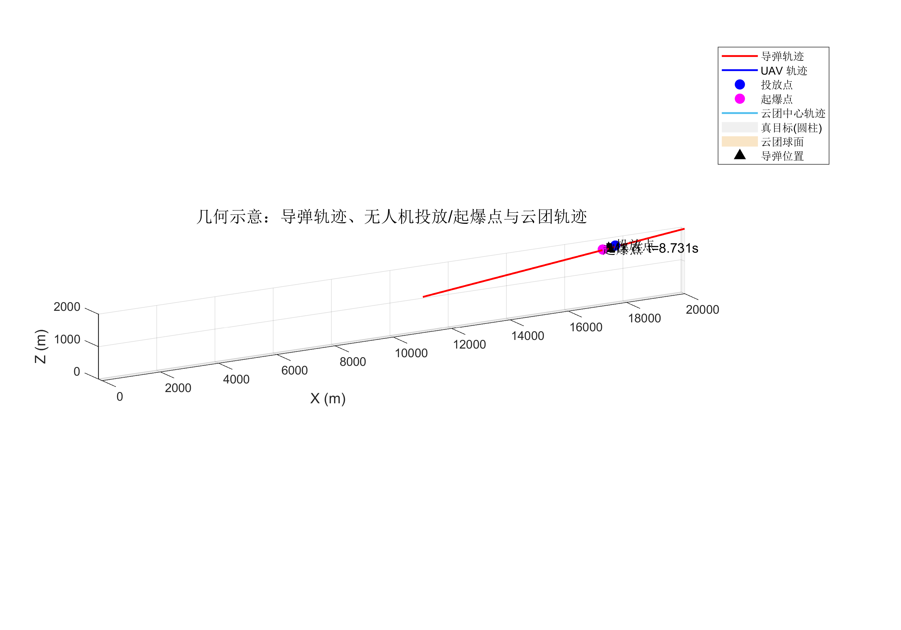
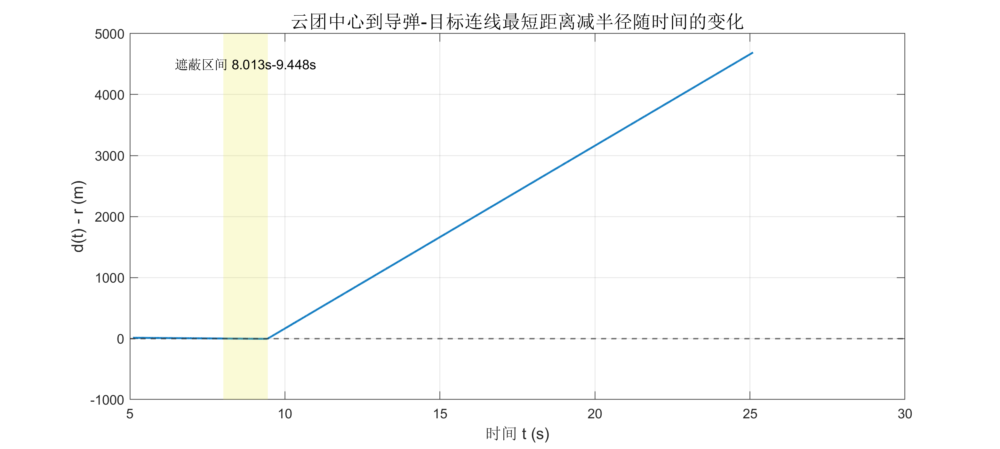
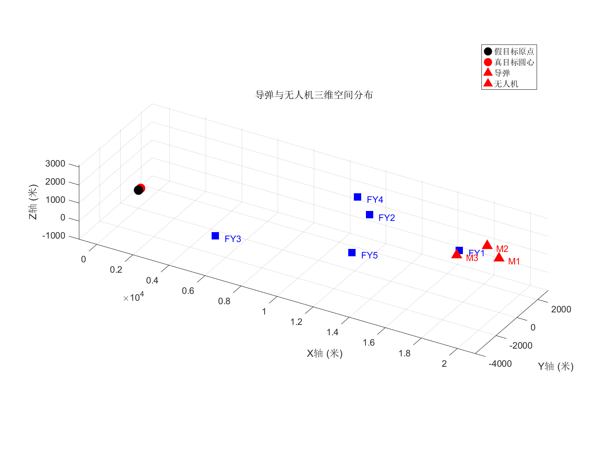

# 烟幕干扰弹投放策略 · 2025 高教社杯 A 题

**场景**：无人机投放烟幕弹，在来袭导弹与真目标之间的视线上形成烟幕遮蔽。

| 文件 | 内容 | 状态 |
| :--- | :--- | :--- |
| [`mathques1.m`](./mathques1.m) | **问题一**：单架无人机 FY1 投 1 枚烟幕弹，求遮蔽时间区间 | ✅ |
| [`question4.m`](./question4.m) | **问题四**：三架无人机 FY1/FY2/FY3 各投 1 枚，最大化 **并集** 遮蔽总时长 | ⚠️ 见下 |
| [`untitled22.m`](./untitled22.m) | 场景三维可视化（导弹与无人机位置） | ✅ |

---

## 结果

### 问题一：三维几何态势



*蓝色圆柱是真目标，球体是烟幕，直线是导弹对目标的视线*

### 问题一：球心到视线距离随时间变化



*`F(t) = d(t) - r` 穿过零点的两个位置就是遮蔽区间的两个端点*

### 场景态势：三枚导弹与五架无人机



---

## 问题一的求解链

投放点 → 起爆点与起爆时刻 → 导弹到达时间 → 逐时刻判断「烟幕球是否挡住视线」→ 得到遮蔽区间。

核心是 **点到线段的最短距离**：视线是导弹到真目标的一条线段，烟幕是一个半径 10 m 的球，只要球心到视线的距离小于半径就算遮蔽。

```
F(t) = d(t) - r
```

`F(t)` 是连续函数，用 **粗网格扫描 + 变号配对 + fzero 精修** 找零点，就得到遮蔽区间的左右端点，再做 **区间合并** 得到总时长。

### 求解结果

```
UAV 投放点 P_drop = [17620.000000, 0.000000, 1800.000000] m
烟幕起爆时刻 t_expl = 5.100000 s
烟幕起爆点 P_c0 = [17188.000000, 0.000000, 1736.496000] m
导弹到原点时间 t_arrival = 66.999171 s
最小距离发生时刻(近似) t_min = 9.418668 s, 对应 F(t_min) = -5.283293e+00
遮蔽时间区间: [8.013006, 9.448088]
遮蔽总时长 = 1.435082 s
```

见 [`results/result_q1.txt`](./results/result_q1.txt)。

---

## 问题四的求解

决策变量有 6 个（3 架无人机各自的投放时刻与引信延时），搜索空间很大，所以用 **粗到细** 的策略：

1. 每架无人机在航向角 `0:10:350`°、速度 `70:10:140` m/s、投放时刻 `0:0.5:8` s、引信延时 `0:0.5:10` s 的网格上粗搜，各留前 6 个候选
2. 枚举 `6^3 = 216` 种组合，对每种算遮蔽区间的 **并集** 长度
3. 对最优的几组用 `fminsearch`（Nelder-Mead）做局部精化
4. 做 ±5% / ±10% 的 **灵敏度分析**，看结果稳不稳

> ⚠️ `question4.m` 的文件头注释写的是 `Author: generated by assistant, Date: 2025-09-05` —— 这个脚本是在 AI 辅助下完成的，如果作为作品展示请注意这一点。

---

## 可复用的工具函数

`mathques1.m` 里包含几个通用函数，独立于本题也能用：

| 函数 | 作用 |
| :--- | :--- |
| `clamp_projection` | 点在线段上的投影（带端点钳制） |
| `merge_intervals` | 区间合并 |
| `find_min_distance` | 用 `fminbnd` 求局部极小 |

---

## 运行

基础 MATLAB 即可，**不需要任何工具箱**。

```matlab
mathques1           % 输出 results/result_q1.mat/.txt 与两张 PNG
question4           % 输出 result2.xlsx / result_q4.mat 与 5 张 PNG（耗时较长）
untitled22          % 输出场景三维态势图
```

---

## 许可

[MIT](./LICENSE) © 2025 liuzunn
